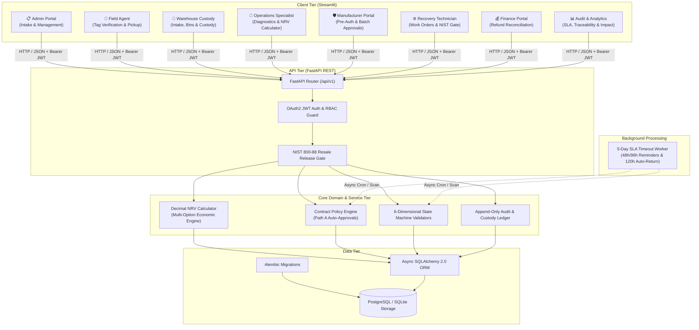

# Sustainable Reverse Logistics System (SRLS)

An enterprise-grade, secure, scalable, and audit-compliant Reverse Logistics and Product Recovery Management Platform designed to orchestrate post-consumer electronic returns. The system manages the full lifecycle of returned electronics: from intake registration, field pickup verification, and warehouse custody tracking, to multi-option Net Recovery Value (NRV) assessment, contract-governed manufacturer authorization (incorporating automated 5-day SLA escalation), NIST SP 800-88 Rev. 1 compliant data sanitization, recovery work order execution, and refund reconciliation.

---

## 🏛️ System Architecture

The solution is implemented as a clean **Modular Monolith** with strict physical and architectural decoupling between the presentation layer, the REST API boundary, the core domain logic, and persistent storage.



---

## 📐 The 6 Orthogonal Lifecycle Dimensions

Unlike legacy monolithic logistics systems that collapse tracking into a single ambiguous status column, SRLS maintains strict separation across **six orthogonal state dimensions**:

| Dimension | Description | Valid States |
| :--- | :--- | :--- |
| **1. Return Case Status** | Overall lifecycle state of the return request | `REGISTERED`, `PICKUP_SCHEDULED`, `PICKED_UP`, `IN_TRANSIT`, `WAREHOUSE_RECEIVED`, `INSPECTED`, `ASSESSED`, `AUTHORIZATION_PENDING`, `AUTHORIZED`, `RECOVERY_IN_PROGRESS`, `RECOVERY_COMPLETED`, `RELEASED`, `CLOSED`, `CANCELLED`, `EXCEPTION` |
| **2. Recovery Classification** | Technical and disposition outcome | `PENDING_INSPECTION`, `RESALE_AS_NEW_ELIGIBLE`, `REPAIR`, `REFURBISHMENT`, `RETURN_TO_MANUFACTURER`, `RECYCLING`, `ON_HOLD` |
| **3. Physical Custody** | Physical location and custodial accountability | `CUSTOMER_PREMISES`, `IN_TRANSIT_PICKUP`, `WAREHOUSE_INTAKE`, `STORAGE_LOCATION`, `INSPECTION_BENCH`, `REPAIR_STATION`, `SANITIZATION_LAB`, `OUTBOUND_STAGING`, `SCRAP_DISPOSAL`, `RETURNED_TO_MFG` |
| **4. Manufacturer Approval** | Manufacturer governance & contractual consent | `NOT_REQUIRED`, `PRE_AUTHORIZED`, `PENDING_REVIEW`, `APPROVED`, `REJECTED`, `EXPIRED_AUTO_RETURN`, `EXPIRED_HOLD` |
| **5. Sanitization Status** | NIST SP 800-88 Rev. 1 data sanitization gate | `NOT_STARTED`, `IN_PROGRESS`, `PASSED`, `FAILED`, `EXCEPTION_REVIEW` |
| **6. Refund Status** | Financial payout and customer reimbursement | `PENDING`, `INITIATED`, `PROCESSING`, `COMPLETED`, `REJECTED` |

---

## 💡 Key Architectural Features

1. **Strict Python `Decimal` / `NUMERIC(12, 2)` Monetary Precision:**
   Monetary calculations, resale estimates, parts costs, labor, and packaging strictly use Python's `Decimal` module and PostgreSQL `NUMERIC` types to prevent floating-point rounding errors.
2. **NIST SP 800-88 Rev. 1 Hard Resale Gate:**
   No device can be released for `RESALE_AS_NEW`, `REPAIR` resale, or `REFURBISHMENT` resale without a cryptographically verifiable sanitization record in `PASSED` status. Attempts to bypass this gate trigger a backend `422 Unprocessable Entity` response.
3. **Transparent Net Recovery Value (NRV) Engine:**
   Evaluates all eligible recovery options side-by-side using the formula:
   $$\text{NRV} = \text{Resale Value} - \text{Repair/Refurb Cost} - \text{Packaging} - \text{Configured Transportation} - \text{Sanitization Cost}$$
   Automatically detects safety hazards (e.g. swollen lithium batteries) and enforces disposition blockers.
4. **Contract-Governed 5-Day SLA Engine:**
   When an item requires manufacturer authorization, a 120-hour SLA countdown begins. Background workers evaluate partner contracts to automatically route non-responsive items to `EXPIRED_AUTO_RETURN` (if contract allows) or `EXPIRED_HOLD` (if hold is required), dispatching reminders at 48 hours and 96 hours.
5. **Multi-Tenant Manufacturer Isolation:**
   Manufacturers log into a dedicated portal that cryptographically restricts data queries to their own products and contracts.
6. **Append-Only Chronological Tracking & Audit Logs:**
   Custody handoffs and business events are recorded in append-only tables with microsecond timestamps, user identities, and contextual metadata.

---

## 🛠️ Technology Stack

- **Backend:** Python 3.10+, FastAPI, Pydantic v2
- **Database & ORM:** PostgreSQL / SQLite (via Async SQLAlchemy 2.0)
- **Database Migrations:** Alembic
- **Frontend:** Streamlit, Plotly (for interactive NRV waterfall breakdowns)
- **Security:** Passlib (Bcrypt password hashing), Python-Jose (JWT OAuth2 tokens)
- **HTTP Client:** HTTPX (fully asynchronous)
- **Testing:** Pytest, Pytest-Asyncio, HTTPX TestClient
- **Containerization:** Docker & Docker Compose

---

## 🚀 Quickstart Guide

### Option 1: Local Development

#### 1. Clone & Set Up Virtual Environment
```bash
# Clone the repository
git clone <repo-url>
cd NewSL

# Create and activate virtual environment
python -m venv .venv

# Windows
.\.venv\Scripts\activate

# Linux / macOS
source .venv/bin/activate

# Install dependencies
pip install -r requirements.txt
```

#### 2. Configure Environment Variables
Copy `.env.example` to `.env`:
```bash
cp .env.example .env
```
*(Default settings use local SQLite database `reverse_logistics.db`, or you can provide PostgreSQL connection strings).*

#### 3. Run Database Migrations
```bash
alembic upgrade head
```

#### 4. Seed Demo Data
Populate the database with initial organizations, role users, a partner contract, pre-authorization policies, and demo return requests:
```bash
python scripts/seed_demo_data.py
```

#### 5. Launch Backend API
```bash
uvicorn backend.app.main:app --reload --host 0.0.0.0 --port 8000
```
- Swagger Interactive Documentation: `http://localhost:8000/docs`
- ReDoc API Specification: `http://localhost:8000/redoc`

#### 6. Launch Frontend Streamlit Portal
In a separate terminal:
```bash
# Windows
.\.venv\Scripts\activate

streamlit run frontend/app.py --server.port 8501
```
- Web Application: `http://localhost:8501`

#### 7. Run Background SLA Worker (Optional)
In a separate terminal or scheduled cron job:
```bash
python backend/app/jobs/timeout_worker.py --loop --interval 60
```

---

### Option 2: Docker Compose

To deploy both FastAPI and Streamlit backed by a dedicated PostgreSQL container:

```bash
docker-compose up --build -d
```

- **Frontend:** `http://localhost:8501`
- **Backend API Docs:** `http://localhost:8000/docs`
- **PostgreSQL Port:** `5432`

---

## 👥 Demo Accounts & Pre-Configured Personas

All demo accounts share the standard password format: `[Role]Secret123!`

| Role | Email | Password | Persona & Typical Tasks |
| :--- | :--- | :--- | :--- |
| **Platform Administrator** | `admin@circularlogistics.com` | `AdminSecret123!` | Create return cases, assign pickups, register organizations, configure contracts |
| **Return Pickup Agent** | `agent@circularlogistics.com` | `AgentSecret123!` | Inspect tags in field, photograph damage, confirm initial pickup custody |
| **Warehouse Specialist** | `inspector@circularlogistics.com` | `InspectorSecret123!` | Scan into storage bins, execute 10-point diagnostics, calculate NRV |
| **Manufacturer Approver** | `approvals@apextech.com` | `PartnerSecret123!` | Review high-value repair requests, define pre-authorization policies |
| **Recovery Technician** | `tech@circularlogistics.com` | `TechSecret123!` | Execute repair work orders, perform NIST 800-88 sanitization, release to resale |
| **Finance Administrator** | `admin@circularlogistics.com` | `AdminSecret123!` | Reconcile payouts, process refund transitions |
| **Auditor / Executive** | `admin@circularlogistics.com` | `AdminSecret123!` | Inspect immutable audit trails, analyze financial recovery waterfall, trigger SLA scans |

---

## 🧪 Automated Testing & Quality Assurance

SRLS includes a test suite covering Unit tests, Role-Based Access Control (RBAC), Multi-Tenant Data Isolation, and full End-to-End lifecycle validation.

### Run All Tests
```bash
# PowerShell
$env:PYTHONPATH="."; .\.venv\Scripts\pytest.exe -v backend/tests

# Bash / Linux / macOS
PYTHONPATH=. pytest -v backend/tests
```

### Test Suite Coverage
- `test_nrv_calculator.py`: Validates exact Decimal calculations, ineligibility flags, lithium safety blockers, and manufacturer return credit economics.
- `test_policy_engine.py`: Verifies Path A pre-authorization thresholds, category filters, and expiration boundaries.
- `test_state_machines.py`: Enforces valid state transitions and asserts that illegal jumps (e.g. `PENDING` directly to `COMPLETED` for refunds) raise validation errors.
- `test_rbac.py`: Proves that field agents cannot register return cases and verifies admin authorization barriers.
- `test_tenant_isolation.py`: Guarantees that Manufacturer A cannot inspect or approve return items belonging to Manufacturer B.
- `test_sanitization_gate.py`: Asserts that attempting to release an unsanitized or uncertified device to resale returns HTTP `422 Unprocessable Entity`.
- `test_timeout_sla.py`: Validates 5-day SLA escalation logic, enforcing partner contract terms for auto-return vs hold.
- `test_end_to_end_lifecycle.py`: Executes a complete 10-step post-consumer journey from intake to resale release and refund completion.

---

## 📚 Technical Documentation Directory

Deep dive into system specifications via the dedicated documentation suite in `docs/`:

- [System Architecture & Modularity](file:///d:/OfficeTCS/NewSL/docs/architecture.md)
- [Database Schema & Migrations](file:///d:/OfficeTCS/NewSL/docs/database_design.md)
- [Business Rules, NRV Formulas & Policy Engine](file:///d:/OfficeTCS/NewSL/docs/business_rules_and_nrv.md)
- [Deployment, Configuration & Runbook](file:///d:/OfficeTCS/NewSL/docs/deployment_guide.md)

---

## 📄 License
Enterprise Commercial & Circular Economy Compliance Standard. Internal / Proprietary.
